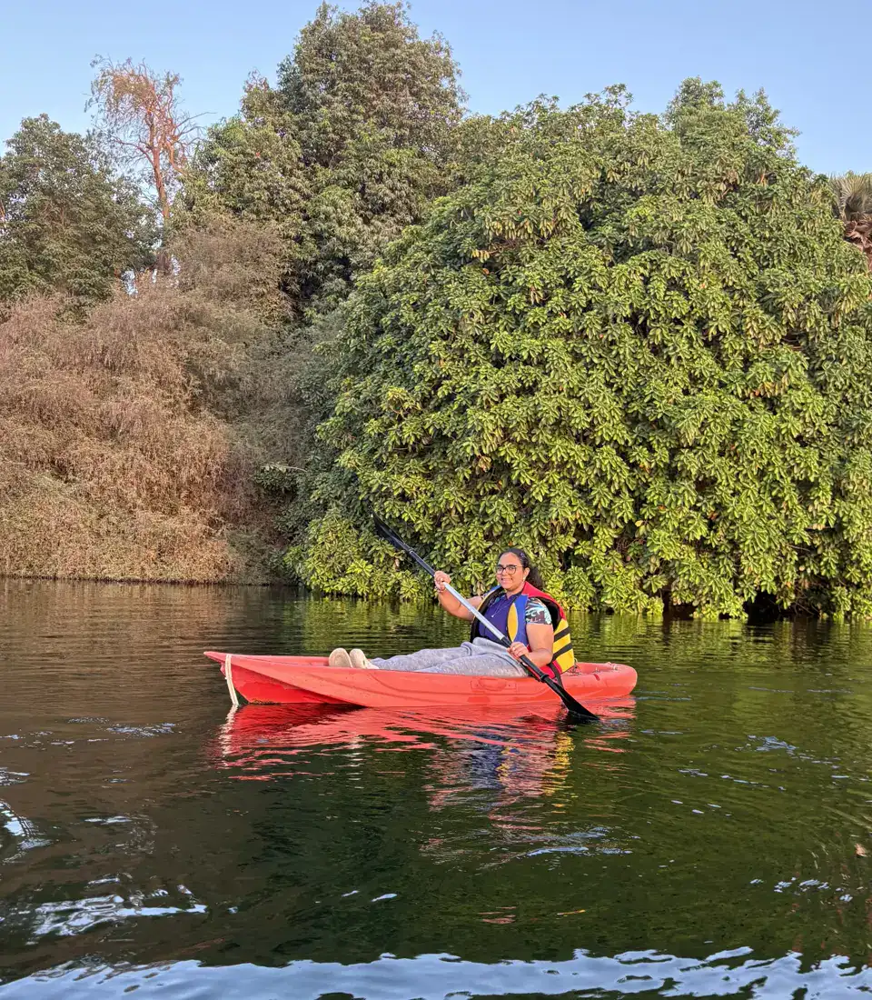
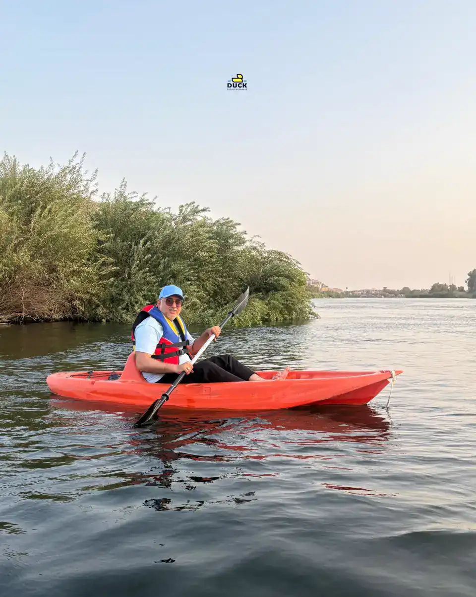

<div align="center">
  

  # 🦆 Duck — Water Sports & Marine Activities Platform

  **"IN DUCK WE TRUST"**  
  *المنصة الرائدة لحجز الأنشطة والتجارب المائية في مصر*

  [](https://duck-lac.vercel.app/)
  [](https://react.dev/)
  [](https://vite.dev/)
  [](https://tailwindcss.com/)
  [](https://reactrouter.com/)
  [](https://duck-lac.vercel.app/)

  <br />

  <h3>
    🌐 <a href="https://duck-lac.vercel.app/">رابط المعاينة الحية المباشرة (Production Live Demo)</a>
  </h3>
</div>

---

## 📸 لقطات من واجهة المنصة (Visual Showcase & Gallery)

| الهيرو السينمائي الرئيسي (Hero Experience) | بوابة حجز المجموعات والشركات (Groups & B2B Live Pass) |
| :---: | :---: |
|  |  |

| تجارب الكاياك في نيل أسوان (Kayaking on the Nile) | ستاند أب بادل ودراجات مائية (SUP & Water Bikes) |
| :---: | :---: |
|  |  |

---

## 🌟 لماذا يبرز هذا المشروع هندسياً؟ (Engineering Differentiators — Why Hire Me?)

هذا المشروع ليس مجرد واجهة مستخدم تجريبية أو موقع استعراضي بسيط، بل هو **تطبيق ويب إنتاجي متكامل (Production-Ready Platform)** يبرهن على مهارات **Senior / Principal Frontend Architect**:

### 1. معمارية FSD الصارمة ومبدأ (DRY & Scalability)
- **فصل المسؤوليات:** تنظيم الكود في طبقات معمارية محكمة (`app`, `pages`, `widgets`, `features`, `entities`, `shared`) يمنع الـ Spaghetti Code تماماً.
- **قاعدة الاستيراد أحادي الاتجاه (Unidirectional Dependency):** لا تستورد أي طبقة إلا من الطبقات الأدنى منها، مع حظر الاستيراد الدائري.
- **مركزية نظام التصميم (Single Source of Truth):** جميع الألوان، المقاسات، الظلال، وأزمنة الحركة معرفة حصرياً في `src/shared/styles/tokens.css` مع مكتبة مكونات مشتركة قابلة لإعادة الاستخدام في `src/shared/ui/`.

### 2. منظومة صلاحيات وأمان تشغيلية لـ 6 أدوار حقيقية (Multi-Role RBAC)
- **تغطية شاملة لكامل المنظومة:**
  1. **العميل (Customer):** متابعة الحجوزات، استعراض تذاكر الـ QR Code، وإدارة الملف الشخصي.
  2. **الإدارة العامة (Admin):** لوحة تحكم بإحصائيات حية، إدارة الحجوزات بكل حالاتها، تعديل الأسعار، وإدارة المستخدمين.
  3. **مزود الخدمة والشريك (Partner / B2B):** إدارة المعدات، المواعيد المتاحة، واستعراض الرحلات المسندة إليه.
  4. **فريق العمليات (Operations):** تأكيد تنفيذ الرحلات ميدانياً وإدارة توافر سترات النجاة والمعدات.
  5. **المرشد السياحي (Tour Guide):** إدارة القوائم الميدانية ونقاط التجمع والمشاركين.
  6. **مدير المحتوى (Content Manager):** تحديث تفاصيل الرحلات والوسائط الترويجية.
- **حماية المسارات:** مسارات مؤمنة بـ `ProtectedRoute`، مع بوابات دخول معزولة للطاقم.

### 3. هندسة الأداء المتقدم ومراعاة تجربة المستخدم (Core Web Vitals)
- **التحميل التكيفي للفيديو (Adaptive Video Guard):** خوارزمية ذكية تفحص اتصال المستخدم عبر `navigator.connection` ونمط توفير البيانات (`Save-Data`) ووضع تقليل الحركة (`prefers-reduced-motion`) لتأجيل أو منع تحميل الفيديوهات الثقيلة واستبدالها تلقائياً بصور WebP مضغوطة.
- **LCP فائق السرعة (< 2.5s):** صور ملصقات الهيرو (Posters) بدقة WebP متجاوبة مع وسم `fetchpriority="high"`.
- **Prewarming في أوقات الخمول:** استخدام دالة المتصفح الحديثة `requestIdleCallback` لتحميل كتل جافاسكريبت للأقسام الموجودة أسفل الشاشة (الخريطة، المراجعات، الأسئلة الشائعة) أثناء خمول المعالج دون تعطيل التحميل الأولي.
- **تقطيع الكود (Route-based Code Splitting):** استخدام `React.lazy` و `Suspense` مع هياكل تحميل انسيابية (Skeletons/Spinners).

### 4. أمان الويب المتقدم (Hardened Security)
- **تشفير كلمات المرور محلياً:** استخدام واجهة المتصفح المشفرة القياسية `window.crypto.subtle` (SHA-256) قبل الحفظ والتحقق.
- **سياسة أمان المحتوى (Strict CSP):** تقييد مصادر تشغيل النصوص والإطارات والخرائط (`maps.google.com`) لمنع هجمات XSS.
- **ترويسات أمان قياسية:** إعداد ترويسات `nosniff`، `X-Frame-Options: DENY` (لمنع Clickjacking)، و `Cross-Origin-Opener-Policy`.
- **سلامة النماذج (Form Semantics):** جميع نماذج تسجيل الدخول والحسابات تستخدم `method="post"` الصريحة وتمنع ظهور أي بيانات اعتماد في روابط الـ URL أو سجلات التصفح.

### 5. محرك تجاري متكامل (Dual B2C & B2B Engine)
- **تسعير مزدوج وشفاف:** حساب فوري لسعر المواطن المصري وسعر السائح الأجنبي مع الجنيه المصري (`EGP`) كأساس وعرض استرشادي للدولار واليورو.
- **Guest Checkout عالي التحويل:** تدفق حجز سريع من 4 خطوات دون فرض تسجيل مسبق، مع إصدار تذاكر رقمية فورية تحتوي على **QR Code** وتفاصيل الحجز ورابط المتابعة.
- **منع الحجز الزائد (Live Inventory):** نظام إدارة الطاقة الاستيعابية اليومية للمعدات (20 كاياك، وحدتان دراجة مائية، ساب حسب الطلب).
- **بوابة حجز المجموعات (`/groups`):** حاسبة تفاعلية وتوليد بطاقة رحلة رقمية حية (**Live Group Pass**) للتواصل الفوري عبر واتساب للشركات والجامعات.

### 6. تدويل متقدم وثنائية لغة أصلية (Native Bi-Directional i18n)
- **تبديل لحظي (Instant Switch):** التبديل بين العربية (**RTL**) والإنجليزية (**LTR**) بضغطة زر وتحديث سمة `dir` على الفور بدون إعادة تحميل الصفحة.
- **خط محلي موحد فائق الخفة:** تضمين خط **`Baloo Bhaijaan 2`** محلياً داخل المشروع للغتين، مما يلغي تماماً وميض الخطوط (FOUT) ويحمي خصوصية المستخدم ويلغي الاعتماد على خوادم Google Fonts الخارجية.

### 7. محركات البحث ومشاركة التواصل (Technical SEO)
- **Canonical ديناميكي:** إدارة تلقائية لوسم `canonical` وعنوان الصفحة `title` والوصف لكل مسار فرعي.
- **بطاقة مشاركة اجتماعية عالية الدقة (`1200×630`):** وسم `og:image` و `twitter:image` موجه لبطاقة مشاركة مخصصة تظهر باحترافية على واتساب وفيسبوك وتويتر ولينكدإن.
- **خريطة موقع محدثة (`sitemap.xml`):** تشمل كافة صفحات الرحلات الإحدى عشرة وصفحات الأنشطة المستقلة، مع استبعاد صفحات الدخول والدفع عبر `robots.txt`.

---

## 1. نظرة عامة (Overview)

تهدف منصة **Duck** إلى تقديم تجربة رقمية فائقة السرعة (**Mobile-First**) وموثوقة لحجز الأنشطة البحرية والنيلية، مع التوسع لتغطية مختلف وجهات مصر (أسوان، الجيزة، سيوة، مرسى مطروح، والبحر الأحمر). تدعم المنصة كلاً من الأفراد (**B2C**) والشركات والمجموعات (**B2B**)، مع لوحة تحكم تشغيلية متكاملة تتيح إدارة الرحلات والأسعار والمخزون دون الحاجة لتعديل الكود البرمجي.

- **نطاق العمل (In-Scope):** تطبيق واجهة أمامية متكامل من الدرجة الإنتاجية (Production-Grade Frontend SPA) يغطي رحلة المستخدم الكاملة من الاستكشاف وحتى الحجز وإصدار التذاكر الرقمية (`QR Code`)، وبوابة حجز المجموعات التفاعلية (`/groups`)، ولوحات التحكم لـ 6 أدوار وفق **RBAC**، مع منظومة تتبع وتحليلات متقدمة (`GA4`, `Meta Pixel`).
- **المرجع الهندسي المعتمد:** مواصفات متطلبات البرمجيات وفق معيار **IEEE 29148** المتزامنة مع التوجه الاستراتيجي المعتمد لمبادرة **CreativeZ** (فريق Tech & Web Track).
- **الهوية البصرية الرسمية (Design Tokens):**
  - **Navy (الكحلي الداكن العميق):** `#0C1226` / `#121826`
  - **Blue (الأزرق المائي النهري):** `#147D9F` / `#067BA1`
  - **Yellow (الأصفر المميز):** `#FDFB45` / `#F5E847`
  - **الخط المعتمد الموحد:** خط **`Baloo Bhaijaan 2`** المدمج محلياً بالكامل للغتين العربية والإنجليزية دون أي استدعاء خارجي لخطوط Google Fonts.

---

## 2. التقنيات المستخدمة (Tech Stack)

تم حصر كافة الحزم والتقنيات مباشرة من بيئة العمل الفعلية:

| الحزمة (Package) | الإصدار (Version) | الغرض الهندسي |
| :--- | :--- | :--- |
| **React** | `^19.3.1` | محرك بناء الواجهات التفاعلية الأحدث |
| **ReactDOM** | `^19.3.1` | إدارة وتصيير شجرة الـ DOM |
| **Vite** | `^8.3.6` | بيئة التطوير وأداة الحزم فائقة السرعة |
| **Tailwind CSS** | `^4.3.5` | إطار عمل التنسيق الذري (Atomic CSS) |
| **@tailwindcss/vite** | `^4.3.5` | تكامل Tailwind v4 المباشر مع محرك Vite |
| **React Router DOM** | `^7.18.6` | إدارة التوجيه، المسارات الديناميكية، والتنقل |
| **Framer Motion** | `^14.14.0` | حركات وتأثيرات انسيابية للواجهة (Micro-Interactions) |
| **Leaflet** | `^1.9.4` | خريطة تفاعلية لعرض مواقع ووجهات النيل والبحر |
| **@fortawesome/react-fontawesome** | `^3.5.0` | المكون الرسمي لتصيير أيقونات Font Awesome داخل React |
| **@fortawesome/fontawesome-svg-core**| `^7.3.1` | نواة الأيقونات المتجهية (SVG Core) |
| **@fortawesome/free-solid-svg-icons** | `^7.3.1` | حزمة الأيقونات المصمتة الرسمية |
| **@fortawesome/free-brands-svg-icons**| `^7.3.1` | أيقونات التواصل الاجتماعي والبراندات الرسمية |
| **@fortawesome/free-regular-svg-icons**| `^7.3.1`| حزمة الأيقونات المفرغة الرسمية |
| **ESLint** | `^10.14.0` | فحص وضمان جودة الكود البرمجي |

---

## 3. التشغيل السريع (Getting Started)

### المتطلبات المسبقة (Prerequisites)
- **Node.js:** إصدار `18.0.0` أو أحدث (يُفضل LTS `v20.x` أو `v22.x`).
- **مدير الحزم:** `npm` (مرفق تلقائيًا مع Node.js).

### أوامر التشغيل والبناء
```bash
# 1. تثبيت الاعتماديات
npm install

# 2. تشغيل السيرفر المحلي للتطوير
npm run dev

# 3. فحص وتدقيق جودة الكود (ESLint)
npm run lint

# 4. بناء المشروع للإنتاج (Production Bundle)
npm run build

# 5. معاينة ناتج البناء محلياً
npm run preview
```

---

## 4. هيكل المشروع الفعلي (Project Structure — FSD Architecture)

يتبع مجلد `src/` معمارية **Feature-Sliced Design (FSD)** المقسمة بدقة لمنع التداخل والفصل التام بين الطبقات:

```text
src/
├── app/                        # الطبقة العليا: التهيئة، المزودات، والتوجيه المركزي
│   ├── providers/              # موفرو السياق (Auth, Language, Currency)
│   ├── routes/                 # حراس التوجيه والصلاحيات (ProtectedRoute)
│   └── App.jsx                 # الجذر الرئيسي ومسارات التطبيق وإدارة SEO
│
├── pages/                      # صفحات التطبيق المستقلة كـ Views كاملة
│   ├── home/                   # الصفحة الرئيسية (HomePage)
│   ├── activities/             # صفحة استعراض الأنشطة + تفاصيل النشاط (Activities & ActivityDetails)
│   ├── trip-details/           # صفحة تفاصيل الرحلة الفردية ونقاط التجمع
│   ├── booking/                # مسار الحجز المتكامل (BookingPage)
│   ├── groups/                 # مسار وبوابة حجز المجموعات
│   ├── about/                  # صفحة «من نحن» السينمائية
│   ├── auth/                   # بوابات الدخول وإنشاء الحساب (Login & CreateAccount)
│   ├── dashboard/              # لوحات التحكم المتخصصة لـ 6 أدوار:
│   │   ├── CustomerDashboardPage.jsx
│   │   ├── AdminDashboardPage.jsx
│   │   ├── PartnerDashboardPage.jsx
│   │   ├── OperationsDashboardPage.jsx
│   │   ├── AgentDashboardPage.jsx
│   │   └── ContentDashboardPage.jsx
│   ├── static/                 # الصفحات القانونية (Privacy, Terms, Cancellation)
│   └── not-found/              # صفحة الخطأ 404 المخصصة
│
├── widgets/                    # كتل واجهة متكاملة ومركبة (Widgets Layer)
│   ├── navbar/                 # الشريط العلوي الرئيسي مع محولات اللغة والعملة
│   ├── header/                 # شريط التنقل السفلي المدمج للموبايل (MobileBottomNav)
│   ├── hero/                   # الهيرو السينمائي مع إطارات ديكورية و DuckManifesto
│   ├── story-gallery/          # قسم المعرض والقصة التعريفية (Classic 3-Gallery Layout & Kinetic Manifesto)
│   ├── brand-intro/            # قسم مدخل الهوية والتجربة (Legacy Alias)
│   ├── destinations/           # بطاقات واستعراض الوجهات السياحية
│   ├── trips/                  # شبكة الرحلات، بطاقات الأسعار، والفلاتر
│   ├── why-duck/               # ركائز التميز ومميزات المنصة
│   ├── groups-banner/          # بانر الانتقال التفاعلي لحجز المجموعات
│   ├── groups-page/            # واجهة حجز المجموعات ومعرض Bento وبطاقة Live Pass
│   ├── map/                    # خريطة مصر والنيل التفاعلية (Leaflet Map)
│   ├── reviews/                # مراجعات وتقييمات Google الموثقة
│   ├── faq/                    # الأسئلة الشائعة وتصنيفاتها التفاعلية
│   ├── final-cta/              # قسم الدعوة الأخيرة للحجز
│   ├── footer/                 # التذييل المؤسسي الشامل
│   ├── notifications/          # جرس وإشعارات الحجوزات اللحظية
│   ├── booking/                # خطوات تدفق الحجز (TripSelect, GuestDetails, ReviewPay, Invoice)
│   └── trip-details/           # مكونات تفاصيل الرحلة (MeetingPoint, Highlights, Addons)
│
├── features/                   # الميزات التفاعلية التي تحقق أهداف المستخدم
│   ├── auth/                   # نماذج تسجيل الدخول، إنشاء الحساب، وحفظ الجلسات
│   ├── guest-checkout/         # معالجة حجز الزائر السريع
│   ├── activity-filter/        # تصفية الرحلات والأنشطة بحسب الوجهة والنوع
│   ├── currency-language-switcher/ # مفتاح تبديل اللغات التفاعلي بقارب الكاياك
│   ├── b2b-quote/              # استمارة طلب عروض أسعار الشركات والمجموعات
│   └── post-booking-account/   # تحويل الزائر إلى حساب مسجل بضغطة زر
│
├── entities/                   # نماذج الأعمال وإدارة البيانات (Domain Entities)
│   ├── user/                   # نموذج المستخدم، المصادقة، والتحقق المشفر (authService)
│   ├── booking/                # نموذج الحجز، الحسابات، التحقق من السعة، والسياسات
│   ├── activity/               # بيانات ونماذج الأنشطة والمواصفات
│   ├── destination/            # بيانات الوجهات ونقاط الانطلاق
│   ├── quote/                  # نموذج عروض أسعار الشركات
│   ├── review/                 # بيانات التقييمات ومراجعات العملاء
│   └── notification/           # إدارة تنبيهات الحجوزات المعلقة
│
├── shared/                     # الأساس المشترك القابل لإعادة الاستخدام بالكامل (DRY)
│   ├── ui/                     # مكتبة المكونات النقية (Button, Badge, Card, Modal, DuckManifesto...)
│   ├── styles/                 # نظام التصميم الموحد (tokens.css)
│   ├── config/                 # الثوابت، المسارات (routes.js)، ومصفوفة الصلاحيات (rbac.js)
│   ├── hooks/                  # الخطافات المخصصة (useTranslation, useCMS, useCurrency...)
│   ├── i18n/                   # قواميس اللغات المركزية (ar.json, en.json)
│   ├── assets/                 # الأصول المحلية الرسمية (صور WebP، فيديوهات، شعارات، وخطوط)
│   └── utils/                  # أدوات التحليلات، التنسيق، وتوليد الأرقام المرجعية
│
├── index.css                   # المتغيرات الأساسية، تعريفات Tailwind، والأنيميشن الحركي
└── main.jsx                    # نقطة انطلاق التطبيق وتثبيته في الـ DOM
```

---

## 5. جدول المسارات المعتمدة (Application Routes)

تُدار جميع المسارات مركزياً من خلال `src/shared/config/routes.js` كـ Single Source of Truth:

| المسار (Route) | الوصف والمكون | مستوى الصلاحية (Access Level) |
| :--- | :--- | :--- |
| `/` | الصفحة الرئيسية واستعراض الرحلات (`HomePageView`) | Public (الجميع) |
| `/activities` | صفحة تصفح جميع فئات الأنشطة المائية (`PublicActivitiesPage`) | Public (الجميع) |
| `/activities/:slug` | تفاصيل النشاط (كاياك، ساب، دراجات مائية) مع رحلاته المباشرة | Public (الجميع) |
| `/trips/:slug` | صفحة تفاصيل الرحلة المحددة ونقاط الانطلاق (`TripDetailsPage`) | Public (الجميع) |
| `/book` | تدفق الحجز التفاعلي المكون من 4 خطوات (`BookingPage`) | Public / Guest |
| `/groups` | بوابة وبانر حجز المجموعات والشركات وحاسبة Live Pass | Public (الجميع) |
| `/about` | صفحة «من نحن» ورسالة المنصة السينمائية (`AboutPage`) | Public (الجميع) |
| `/privacy-policy` | سياسة الخصوصية وحماية البيانات (`StaticInfoPage`) | Public (الجميع) |
| `/terms-and-conditions` | الشروط والأحكام العامة للخدمة (`StaticInfoPage`) | Public (الجميع) |
| `/cancellation-policy` | سياسة الإلغاء والاسترداد المالي المرنة 24 ساعة | Public (الجميع) |
| `/login` | بوابة تسجيل الدخول الرسمية (`LoginPage`) | Public (نموذج آمن بـ POST) |
| `/signup` | صفحة إنشاء حساب جديد للعملاء والشركاء (`CreateAccountPage`) | Public |
| `/dashboard` | لوحة تحكم العميل لمتابعة التذاكر والحجوزات | دور `Customer` فقط |
| `/portal/admin` | لوحة الإدارة العامة والتحكم بالرحلات والأسعار والمستخدمين | دور `Admin` فقط |
| `/portal/partner` | لوحة الشريك ومزود الخدمة لإدارة المعدات والمواعيد | دور `Partner` فقط |
| `/portal/ops` | لوحة فريق العمليات والتشغيل الميداني وتأكيد التنفيذ | دور `Operations` فقط |
| `/portal/agent` | لوحة المرشدين السياحيين ووكلاء الحجز الميدانيين | دور `Tour Guide` فقط |
| `/portal/content` | لوحة مدير المحتوى لتحديث الوسائط والوصف والعروض | دور `Content Manager` فقط |
| `*` | صفحة الخطأ المخصصة 404 (`NotFoundPage`) | Public |

---

## 6. منظومة الصلاحيات متعددة الأدوار (6-Role RBAC System)

تعتمد المنصة حماية متقدمة عبر مصفوفة صلاحيات موزعة ومحمية عبر مكون `ProtectedRoute.jsx`:

1. **العميل (`Customer`):** إدارة الحجوزات السابقة والحالية، استعراض تذاكر الـ QR Code، وتعديل البيانات الشخصية.
2. **الإدارة العامة (`Admin`):** مراقبة شاملة للمؤشرات والإيرادات، إدارة جميع الحجوزات وتغيير حالاتها الستة (`Pending, Confirmed, Paid, Completed, Cancelled, Refunded`)، وتعديل أسعار الرحلات والمستخدمين.
3. **الشريك ومزود الخدمة (`Partner / B2B`):** استعراض الحجوزات المسندة إليه فقط، إدارة طاقة معداته، وتنسيق المواعيد اليومية.
4. **فريق العمليات والتشغيل (`Operations`):** التأكيد الميداني لتنفيذ الرحلات ونقلها من حالة `Confirmed` إلى `Completed`، ومتابعة جاهزية سترات النجاة والمعدات.
5. **المرشد السياحي (`Tour Guide / Agent`):** متابعة القوائم اليومية، أسماء المشاركين، وإدارة المجموعات في نقاط التجمع الميدانية.
6. **مدير المحتوى (`Content Manager`):** تحديث نصوص الرحلات، الصور الفوتوغرافية، التقييمات، والعروض الترويجية.

---

## 7. قواعد العمل والمنطق التشغيلي (Business Rules)

| قاعدة العمل (Business Rule) | التفاصيل الهندسية | الموقع في الكود |
| :--- | :--- | :--- |
| **الطاقة الاستيعابية والمخزون** | كاياك = **20 وحدة**، دراجات مائية = **وحدتان**، ساب = **حسب الطلب**؛ منع تضارب المواعيد آلياً. | `src/entities/booking/lib/capacityValidator.js` |
| **التسعير المزدوج والعملات** | الجنيه المصري (**EGP**) أساس الحسابات، مع عرض استرشادي للدولار واليورو بناءً على جنسية الحاجز. | `src/widgets/trips/` & `src/shared/hooks/` |
| **سياسة الإلغاء المرنة** | استرداد كامل بنسبة 100% عند الإلغاء قبل موعد الرحلة بأكثر من 24 ساعة. | `src/shared/config/constants.js` |
| **السلامة والوزن الأقصى** | الحد الأقصى للوزن **130 كجم** للمشارك؛ والسباحة غير مطلوبة بفضل سترات النجاة المعتمدة. | `src/shared/config/constants.js` |
| **التذاكر الرقمية والـ QR** | إصدار رقم حجز مرجعي فريد وتذكرة مشفرة بـ QR Code مع إمكانية التحميل والإرسال لواتساب. | `src/widgets/booking/StepPaymentInvoice.jsx` |
| **التحليلات وتتبع التحويل** | تتبع الأحداث الحيوية: `Page View`, `View Activity`, `Initiate Booking`, `Purchase`. | `src/shared/utils/analytics.js` |

---

## 8. الأداء، الأمان، والـ SEO المتقدم (Performance & Security)

### هندسة الأداء (Core Web Vitals):
- **Deferred Hero Video:** لا يبدأ تحميل الفيديو عالي الدقة إلا بعد اكتمال جاهزية الصفحة مع مهلة ذكية (1.5 ثانية)، ويتم تعطيله تلقائياً إذا كان المستخدم في وضع توفير البيانات (`Save-Data`) أو على شبكة 2G بطيئة أو مفعل لوضع تقليل الحركة (`prefers-reduced-motion`).
- **High-Priority WebP Posters:** صورة ملصق الهيرو مُحسنة بتنسيق WebP وبدقة متجاوبة لضمان تحقيق LCP قياسي (< 2.5 ثانية).
- **Idle Prewarming:** استخدام دالة المتصفح الحديثة `requestIdleCallback` لتحميل الأقسام الموجودة أسفل الشاشة (الخريطة والمراجعات والأسئلة الشائعة) أثناء خمول المعالج دون إبطاء التحميل الأولي.
- **Dynamic Code Splitting:** استخدام `React.lazy` و `Suspense` مع مؤشرات تحميل انسيابية لكل صفحة وقطاع.

### الأمان والخصوصية (Hardened Security):
- **Content Security Policy (CSP):** سياسة أمان صارمة تحدد المصادر الموثوقة بدقة (خرائط جوجل، طقس Open-Meteo).
- **HTTP Security Headers:** إعداد ترويسات `nosniff`, `X-Frame-Options: DENY`, `Referrer-Policy: strict-origin-when-cross-origin`, و `Cross-Origin-Opener-Policy`.
- **Client-Side SHA-256 Hashing:** تشفير كلمات المرور باستخدام واجهة المتصفح القياسية `window.crypto.subtle` قبل التحقق، مع منع إرسال بيانات الاعتماد في روابط الـ URL أو سجلات التتبع.
- **Form Semantics:** ضبط نماذج تسجيل الدخول والحسابات على `method="post"` الصريحة لتفادي أي سلوك تسريب في المتصفحات القديمة.

### محركات البحث ومشاركة التواصل (Technical SEO):
- **Dynamic Canonical & Title Management:** تحديث تلقائي وديناميكي لوسوم `document.title` والرابط المعياري `canonical` لكل مسار لمنع تكرار المحتوى.
- **Social Share Card (1200×630):** وسم `og:image` و `twitter:image` موجه لبطاقة مشاركة عالية الجودة لتطبيق واتساب وفيسبوك ولينكدإن.
- **Smart Robots & Sitemap:** ملف `robots.txt` يحجب مسارات لوحات التحكم والدفع غير المخصصة للفهرسة، وملف `sitemap.xml` يضم كافة صفحات الرحلات الإحدى عشرة والأنشطة والصفحات الأساسية.

---

## 9. التدويل ونظام التصميم الموحد (Design System & i18n)

### خط موحد Baloo Bhaijaan 2 محلياً:
تم تضمين أوزان خط **Baloo Bhaijaan 2** محلياً داخل مجلد `src/shared/assets/fonts/`، ويُطبق افتراضياً عبر `tokens.css` على النصوص العربية والإنجليزية، مما يمنح الموقع مظهراً احترافياً وأداءً فورياً خالياً من وميض الخطوط غير المحملة (FOUT).

### شعار وهوية "IN DUCK WE TRUST":
تم استبدال الشارات التقليدية بمكون الهوية الحركي **`DuckManifesto`** الذي يدمج أمواج النيل المتدفقة (`SVG Nile Wave Animation`) مع شارة فينيل ثلاثية الأبعاد مائلة تعكس الروح الرياضية والمغامرة المائية المصرية الأصيلة.

### ثنائية اللغة المتزامنة (Instant i18n):
- ملفات الترجمة المركزية في `src/shared/i18n/ar.json` و `en.json`.
- التبديل الفوري يغير سمة `dir` على الجذر (`rtl` / `ltr`) وتوزيع الواجهة بدون الحاجة لإعادة تحميل الصفحة.

---

## 10. بيانات التواصل والمصدر الرسمي (Contact & Official Info)

- **الموقع المنشور (Vercel Live App):** [https://duck-lac.vercel.app/](https://duck-lac.vercel.app/)
- **الموقع الرسمي الأساسي:** [https://www.duckegy.com/](https://www.duckegy.com/)
- **البريد الإلكتروني الرسمي:** [duck.asw@gmail.com](mailto:duck.asw@gmail.com)
- **المبادرة:** CreativeZ — Track: Tech & Web
- **شعار المشروع:** *"IN DUCK WE TRUST"* 🦆🌊
